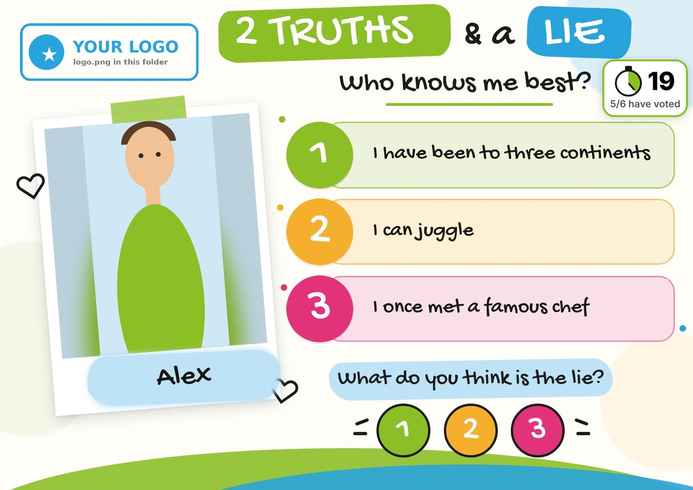
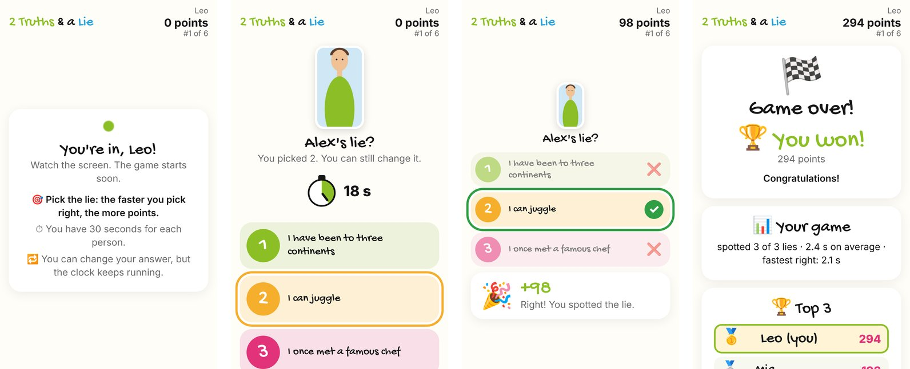
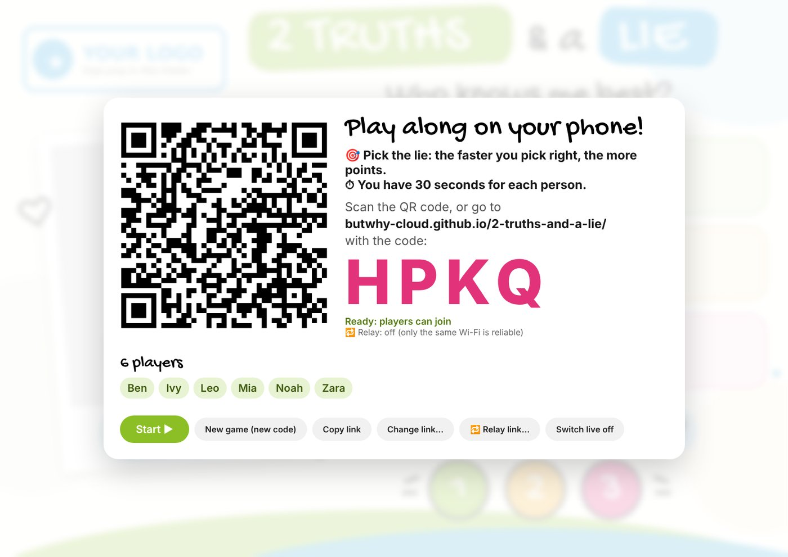
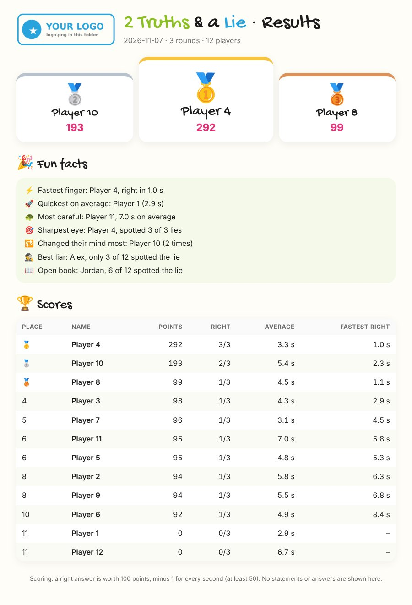

# 2 Truths & a Lie

A live version of the classic party game for classrooms, team days and youth groups. Each person's photo and three statements go up on the projector, and everyone guesses the lie on their own phone. Quick right answers score the most points.

You don't need to install anything or create any accounts. The game runs in the browser on the host's laptop, and players join by scanning a QR code.



Open the game: [English](https://butwhy-cloud.github.io/2-truths-and-a-lie/projector.html) · [Afrikaans](https://butwhy-cloud.github.io/2-truths-and-a-lie/projektor.html)

**New to this? Follow the step-by-step guide:** [English](https://butwhy-cloud.github.io/2-truths-and-a-lie/guide.html) ([PDF](guide.pdf)) · [Afrikaans](https://butwhy-cloud.github.io/2-truths-and-a-lie/gids.html) ([PDF](gids.pdf)). It walks you through downloading the game, filling in the spreadsheet, adding photos and playing, with a picture for every step.

## How a round works

1. The host picks a person. Their photo, name and three statements appear on every phone, and on the projector if there is one. (The person on the card knows the lie, so they sit that round out.)
2. Everyone taps the statement they think is the lie. They have 30 seconds: a stopwatch on the projector and on every phone fills up as the time runs, and turns pink for the last 5 seconds. The projector also shows how many people have voted.
3. At 0, voting closes. Whatever each player picked stays, and anyone who didn't pick gets no points for that person. If the host marks the lie before the time is up, the clock stops and so does voting, so it's best to wait for the countdown or until everyone has voted.
4. The person tells everyone which one was the lie, and the host taps that number.
5. Each phone shows whether the player was right and how many points they got.

When the host ends the game, the projector shows the final scores and a few fun facts, like the fastest player and the person whose lie fooled the most people. Every phone shows the player's own place and the top 3.



## Getting started

You'll need a computer or laptop with Chrome or Edge to host the game (not a phone or tablet), a projector or big screen if you have one, and internet on the computer and the phones.

1. Make a folder with a spreadsheet and photos. Start from the empty spreadsheet ([`templates/statements.xlsx`](templates/statements.xlsx), or [`stellings.xlsx`](templates/stellings.xlsx) in Afrikaans), or copy an example folder: [`example`](example/) or [`voorbeeld`](voorbeeld/).
2. Open the game ([English](https://butwhy-cloud.github.io/2-truths-and-a-lie/projector.html) or [Afrikaans](https://butwhy-cloud.github.io/2-truths-and-a-lie/projektor.html)) and click **Choose the folder**.
3. Click **📱 Live** and then **Switch live on**. A QR code and a 4-letter code appear for the players.
4. When everyone has joined, click **Start** and pick the first person.

Try it with two or three phones before the real thing. Some school and office networks block this kind of connection, and mobile data usually works when Wi-Fi doesn't.



## The folder

The game needs a spreadsheet and, if you like, photos and a logo, all in one folder:

```
example/
├── statements.xlsx
├── person 1.jpg
├── person 2.jpg
├── person 3.jpg
└── logo.png        (optional)
```

The spreadsheet has one row per person:

| Person | Name | Statement 1 | Statement 2 | Statement 3 |
|---|---|---|---|---|
| Person 1 | Alex | I have been to three continents | I can juggle | I once met a famous chef |
| Person 2 | Sam | I play the guitar | I have two cats | I have never seen snow |

- The headings can be in English (`Name`, `Statement 1`–`3`) or Afrikaans (`Naam`, `Stelling 1`–`3`). Their order doesn't matter, and other columns are ignored.
- The `Person 1`, `Person 2`… column links each row to its photo, `person 1.jpg`, `person 2.jpg` and so on. A photo can also be named after the person, like `Alex.jpg`.
- Don't put the lie in the spreadsheet. Each person tells the group during the game.
- Add a `logo.png` and your school's or company's logo appears on the card: in the corner of the built-in card, in a free corner of the ready-made cards, and wherever you put it on a card of your own (see *Your own card*).

## Scoring

A right answer is worth 100 points, minus one point for every second you take. A wrong answer, or no answer in time, gets nothing.

Everyone has 30 seconds for each person, so a right answer scores between 70 and 100: after 2 seconds it scores 98, and just before the time runs out it scores 70. The clock starts when the person appears on the screen and stops at your last tap, so you can change your mind, but it costs you a little time.

## Results

When the game ends, the results are saved as a spreadsheet in your folder. You can also save a results page with the podium, the fun facts and everyone's points and times, which is handy for sharing afterwards.



## Your privacy

Your spreadsheet, photos and results stay on the host's laptop. Nothing is uploaded to this site or anywhere else. During a round the laptop sends that person's statements, name and a small copy of their photo straight to the players' phones, and that's all.

When the game ends, everyone is disconnected and the laptop and phones forget the game. The only thing left is the results file you saved. Every game gets a new code, and the host can remove anyone who shouldn't be there.

The services the game uses keep the ordinary server logs any website does, never game content. GitHub, which hosts these pages, logs visitors' IP addresses for security (see the [GitHub Privacy Statement](https://docs.github.com/en/site-policy/privacy-policies/github-general-privacy-statement)). The PeerJS service that introduces the phones to the laptop, and the relay server if you use one, see network addresses too.

If you play with children, use their names and photos only with permission, for example a parent's or guardian's. In South Africa that's what POPIA asks of the school or club running the game. The results file you save has players' nicknames and scores, so keep it only as long as you need it.

Chrome may say it's "uploading" files when you pick the folder. That's just how Chrome describes giving a page access to a folder. The files are only read on the laptop.

## Playing across different networks

How players can join depends on the networks they're on:

| Players are on | What you need |
|---|---|
| The same Wi-Fi as the laptop (or a phone hotspot the laptop is on too) | Nothing extra. This works out of the box. |
| Mobile data, or a different Wi-Fi | Your own relay server (TURN), from Cloudflare or Metered. |

Most mobile and school networks don't let a phone connect straight to a laptop. The connection then has to go through a relay server. PeerJS has a free shared one, but it's used by everyone and in practice only lets one phone on mobile data in at a time.

There are two easy ways to get your own relay:

| | Cloudflare (recommended) | Metered |
|---|---|---|
| Free each month | 1,000 GB | 500 MB |
| Enough for | practically any number of games | about 500 players in total, so a few small sessions |
| Setup | a small Worker, about 10 minutes | copy two values from the dashboard |

A player uses roughly 0.5 to 1 MB per game through the relay.

### Option 1: Cloudflare

1. In the Cloudflare dashboard, go to **Realtime → TURN Server** and create a TURN key. Note the **Turn Token ID** and the **API Token**.
2. Go to **Workers & Pages → Create** and choose **Start with Hello World!** (not a GitHub repository). Name it, deploy it, then **Edit code**: replace everything with [`tools/relay-worker.js`](tools/relay-worker.js) and deploy again.
3. In the Worker's **Settings → Variables and Secrets**, add three variables of type **Secret** (not Text): `TURN_KEY_ID` and `TURN_KEY_API_TOKEN` (from step 1), and `ACCESS_CODE` (a password of your own). Leave **Cloudflare Access** switched off for this Worker: the players' phones need to reach it without logging in, and the access code already protects it.
4. Make a **private** copy of `projector.html` (or `projektor.html`), search for `RELAY_URL` and `RELAY_KEY`, and fill in your Worker's address and your access code. Keep that copy on your laptop and don't put it in a public repository.
5. Open your copy. The join screen should say **🔁 Relay: on**.

The Worker hands out fresh relay details that last a day, so the Cloudflare key never leaves Cloudflare.

### Option 2: Metered

1. Sign up at [metered.ca](https://www.metered.ca) and create an app on the free plan. Your app gets an address that ends in `.metered.live`.
2. In the dashboard, find the API key for your TURN credentials.
3. Make a **private** copy of `projector.html` (or `projektor.html`) and fill in:
   - `RELAY_URL`: `https://<your-app>.metered.live/api/v1/turn/credentials`
   - `RELAY_KEY`: your API key

   Keep that copy on your laptop and don't put it in a public repository.
4. Open your copy. The join screen should say **🔁 Relay: on**.

Metered hands out relay details for your app, and the game picks the right servers for your plan by itself. When the free 500 MB runs out, the relay stops until the next month, or until you upgrade.

### How the phones get the relay

With either option, the QR code gives the phones the relay address and key after a `#` in the link. That part of a link is never sent to a website, and each phone removes it from the address bar right away. Phones that use the relay show **🔁 Relay: on** while connecting.

Anyone who has the link can use your relay while they have it, just like they can join the game. If you want, change the access code (Cloudflare) or the API key (Metered) after a session.

### Sharing your relay with another group

You can let a school or club use your Cloudflare relay without giving them your own code, and switch them off again on their own:

1. In the Worker's **Settings → Variables and Secrets**, add a **Secret** called `ACCESS_CODES` with one code per group, separated by commas, like `school-7k2m, club-9x4q`. Your own `ACCESS_CODE` keeps working. (The Worker needs the latest [`tools/relay-worker.js`](tools/relay-worker.js).)
2. Send the group their relay link privately, for example: `https://butwhy-cloud.github.io/2-truths-and-a-lie/projector.html#relay=https://<your-worker>.workers.dev/&key=school-7k2m`
3. They open it once on the computer they host on. The game remembers it there and says **🔁 The relay is now on for this computer**. With the downloaded game file, they paste the link on the join screen under **🔁 Relay link…** instead.
4. To stop a group, remove its code from `ACCESS_CODES`. Their game then simply plays without a relay.

The link is stored only in that computer's browser. Pasting an empty link under **🔁 Relay link…** removes it.

## Controls

| To do this | Click | Or press |
|---|---|---|
| Show a person | their number | the number |
| Next or previous person | ◀ ▶ | ← → |
| Random person | 🎲 | Space |
| Mark the lie | 1, 2 or 3 on the card | |
| Scores | 🏆 | L |
| End the game | 🏁 | |
| Start a completely new game | ✕ | Esc |
| Print a page per person | 🖨 | Ctrl+P |
| Full screen | ⛶ | F |

## Using it for your own group

You can fork this repository and switch on GitHub Pages (Settings → Pages → `main` branch). Your copy then works straight away at `https://<your-name>.github.io/<repo>/projector.html`, and its QR code points to your own phone page.

## Your own card

The game has its own card built in, but you can use any picture as the card.

- **Ready-made cards:** [`templates/cards/`](templates/cards/) has a Christmas card in English and Afrikaans, and a navy-and-gold card in Afrikaans. Download one and put it in your folder; its name already starts with `card` or `kaart`, which is how the game recognises it. These cards carry their own layout, so they work straight away.
- **Your own design:** name the picture `card` or `kaart` (for example `card.jpg` or `kaart skool.png`) and put it in your folder. The first time you choose the folder, the game shows your card with boxes. Drag them onto the spots for the photo, the name, the three statements, the 1-2-3 circles, the vote counter and your logo (if the folder has one), and click **💾 Save layout**. Save `card.json` in the same folder and the game uses it from then on. Click **🎨** in the bar to change it later.

Keep only one card picture in the folder. Any shape works (the ready-made cards are 16:9), and printing fits it onto an A4 page.

## How it works

The host's laptop runs the game. Phones connect to it directly over an encrypted connection (WebRTC), and a free service called [PeerJS](https://peerjs.com) only helps them find each other.


We tested it with 100 simulated players on one laptop. Everyone joined within a few seconds and results reached every phone almost instantly. With real phones, the network matters more than the number of players.

## Files

| File | What it is |
|---|---|
| `projector.html` | The game, in English |
| `index.html` | The page players open on their phones (English) |
| `projektor.html` | The game, in Afrikaans |
| `speel.html` | The page players open on their phones (Afrikaans) |
| `guide.html`, `gids.html` | The step-by-step guide, in English and Afrikaans |
| `guide.pdf`, `gids.pdf` | The same guide as a PDF to print |
| `templates/` | Empty spreadsheets to fill in (`statements.xlsx`, `stellings.xlsx`), and ready-made cards in `templates/cards/` |
| `example/`, `voorbeeld/` | Example folders with a spreadsheet, photos and a logo |
| `tools/relay-worker.js` | A small Cloudflare Worker that hands out relay details (see *Option 1: Cloudflare*) |
| `docs/` | Pictures for this page and the guide |
| `SECURITY.md` | How to report a security or privacy problem, and what the game keeps |
| `.github/workflows/downloads.yml` | Keeps the [downloads release](https://github.com/butwhy-cloud/2-truths-and-a-lie/releases/tag/downloads) up to date, so the PDF guide's buttons download files directly |

## Good to know

- The host's browser tab needs to stay open for the whole game.
- Photos only show on the phones if you choose the folder with **Choose the folder**. A browser won't share photos it merely found next to the page.
- Saving results straight into your folder works in Chrome and Edge. Other browsers put the file in Downloads.
- We tested in Chromium with simulated phones. Do a quick test with your own devices before a session.

## Licence

The code is free to use under the [MIT licence](LICENSE). The built-in PeerJS, qrcode-generator and Gochi Hand font have their own licences, listed in [THIRD-PARTY-LICENSES.txt](THIRD-PARTY-LICENSES.txt).
