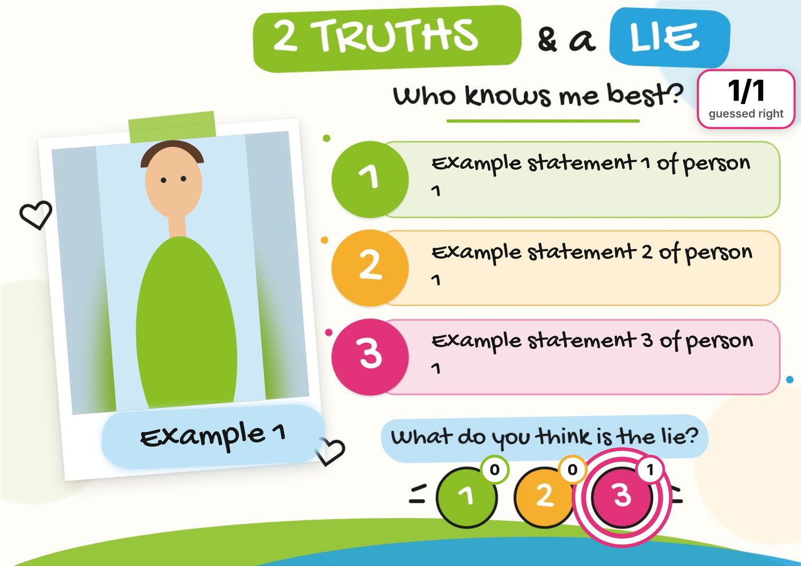
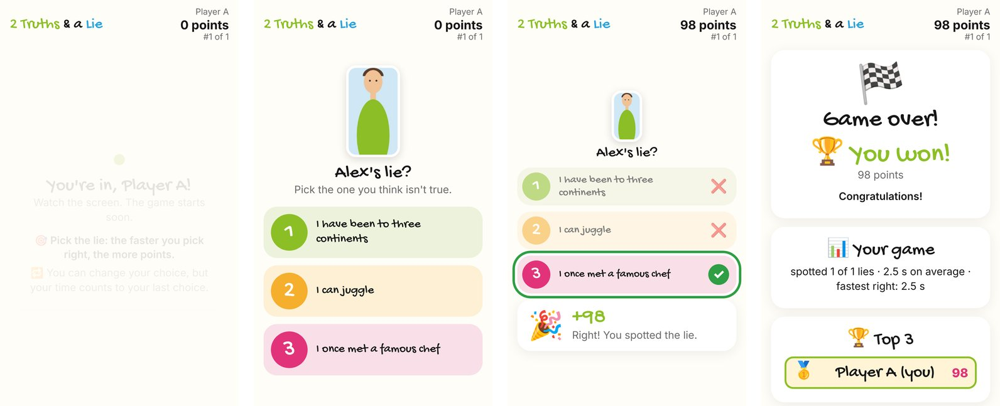
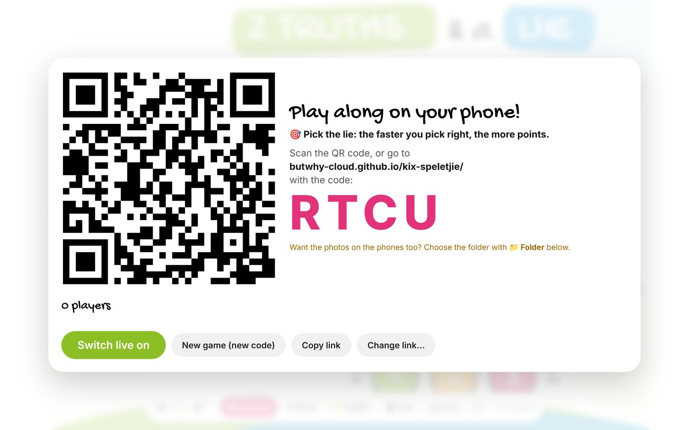
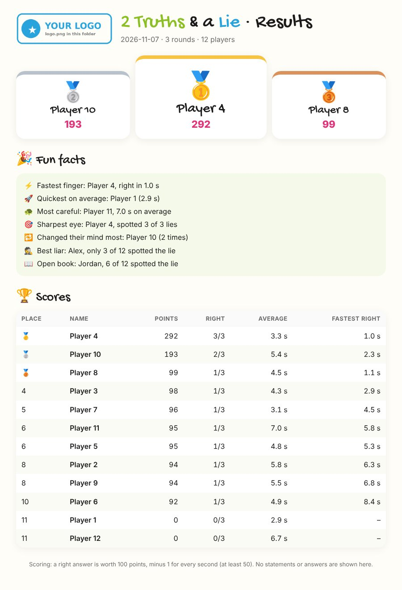

# 2 Truths & a Lie

A live version of the classic party game for classrooms, team days and youth groups. Each person's photo and three statements go up on the projector, and everyone guesses the lie on their own phone. Quick right answers score the most points.

You don't need to install anything or create any accounts. The game runs in the browser on the host's laptop, and players join by scanning a QR code.



Open the game: [English](https://butwhy-cloud.github.io/2-truths-and-a-lie/projector.html) · [Afrikaans](https://butwhy-cloud.github.io/2-truths-and-a-lie/projektor.html)

## How a round works

1. The host picks a person. Their photo, name and three statements appear on the projector, and on every phone.
2. Everyone taps the statement they think is the lie. The projector shows how many people have voted.
3. The person tells everyone which one was the lie, and the host taps that number.
4. Each phone shows whether the player was right and how many points they got.

When the host ends the game, the projector shows the final scores and a few fun facts, like the fastest player and the person whose lie fooled the most people. Every phone shows the player's own place and the top 3.



## Getting started

You'll need a laptop with Chrome or Edge, a projector, and internet on the laptop and the phones (Wi-Fi or mobile data).

1. Make a folder with a spreadsheet and photos. The easiest way is to copy the example folder: [`example`](example/) for English, or [`voorbeeld`](voorbeeld/) for Afrikaans.
2. Open the game ([English](https://butwhy-cloud.github.io/2-truths-and-a-lie/projector.html) or [Afrikaans](https://butwhy-cloud.github.io/2-truths-and-a-lie/projektor.html)) and click **Choose the folder**.
3. Click **📱 Live** and then **Switch live on**. A QR code and a 4-letter code appear for the players.
4. When everyone has joined, click **Start** and pick the first person.

Try it with two or three phones before the real thing. Some school and office networks block this kind of connection, and mobile data usually works when Wi-Fi doesn't.



## The folder

The game needs a spreadsheet and, if you like, photos and a logo, all in one folder:

```
example/
├── statements.xlsx
├── person 1.jpg
├── person 2.jpg
├── person 3.jpg
└── logo.png        (optional)
```

The spreadsheet has one row per person:

| Person | Name | Statement 1 | Statement 2 | Statement 3 |
|---|---|---|---|---|
| Person 1 | Alex | I have been to three continents | I can juggle | I once met a famous chef |
| Person 2 | Sam | I play the guitar | I have two cats | I have never seen snow |

- The headings can be in English (`Name`, `Statement 1`–`3`) or Afrikaans (`Naam`, `Stelling 1`–`3`). Their order doesn't matter, and other columns are ignored.
- The `Person 1`, `Person 2`… column links each row to its photo, `person 1.jpg`, `person 2.jpg` and so on. A photo can also be named after the person, like `Alex.jpg`.
- Don't put the lie in the spreadsheet. Each person tells the group during the game.
- Add a `logo.png` and your school's or company's logo appears in the corner of the card.

## Scoring

A right answer is worth 100 points, minus one point for every second you take, but never less than 50. A wrong answer gets nothing.

So a right answer after 2 seconds scores 98, and after 30 seconds it scores 70. The clock starts when the person appears on the screen and stops at your last tap, so you can change your mind, but it costs you a little time.

## Results

When the game ends, the results are saved as a spreadsheet in your folder. You can also save a results page with the podium, the fun facts and everyone's points and times, which is handy for sharing afterwards.



## Your privacy

Your spreadsheet, photos and results stay on the host's laptop. Nothing is uploaded to this site or anywhere else. During a round the laptop sends that person's statements, name and a small copy of their photo straight to the players' phones, and that's all.

When the game ends, everyone is disconnected and the laptop and phones forget the game. The only thing left is the results file you saved. Every game gets a new code, and the host can remove anyone who shouldn't be there.

Chrome may say it's "uploading" files when you pick the folder. That's just how Chrome describes giving a page access to a folder. The files are only read on the laptop.

## Controls

| To do this | Click | Or press |
|---|---|---|
| Show a person | their number | the number |
| Next or previous person | ◀ ▶ | ← → |
| Random person | 🎲 | Space |
| Mark the lie | 1, 2 or 3 on the card | |
| Scores | 🏆 | L |
| End the game | 🏁 | |
| Start a completely new game | ✕ | Esc |
| Print a page per person | 🖨 | Ctrl+P |
| Full screen | ⛶ | F |

## Using it for your own group

You can fork this repository and switch on GitHub Pages (Settings → Pages → `main` branch). Your copy then works straight away at `https://<your-name>.github.io/<repo>/projector.html`, and its QR code points to your own phone page.

The card picture is built into `projector.html`. To use your own design, keep the same layout (photo on the left, three bars on the right, name under the photo, 1-2-3 circles at the bottom) and swap the picture.

## How it works

The host's laptop runs the game. Phones connect to it directly over an encrypted connection (WebRTC), and a free service called [PeerJS](https://peerjs.com) only helps them find each other.

**Mobile data and strict networks.** Some networks don't allow a direct connection, and then a relay server (TURN) is needed in between. The free one PeerJS uses is shared by everyone and can't be relied on: in practice only one phone on mobile data got in at a time. To use your own, get a free TURN account at [metered.ca](https://www.metered.ca), and in a **private copy** of the projector page fill in `RELAY_LOGIN = "username:password"`. The QR code then passes the relay details to the phones after a `#` in the link, which is never sent to a website. Don't put your login in a public repository. Everything the game needs, including PeerJS, the QR code maker and the handwriting font, is built into the pages.

We tested it with 100 simulated players on one laptop. Everyone joined within a few seconds and results reached every phone almost instantly. With real phones, the network matters more than the number of players.

## Files

| File | What it is |
|---|---|
| `projector.html` | The game, in English |
| `index.html` | The page players open on their phones (English) |
| `projektor.html` | The game, in Afrikaans |
| `speel.html` | The page players open on their phones (Afrikaans) |
| `example/`, `voorbeeld/` | Example folders with a spreadsheet, photos and a logo |
| `docs/` | Pictures for this page |

## Good to know

- The host's browser tab needs to stay open for the whole game.
- Photos only show on the phones if you choose the folder with **Choose the folder**. A browser won't share photos it merely found next to the page.
- Saving results straight into your folder works in Chrome and Edge. Other browsers put the file in Downloads.
- We tested in Chromium with simulated phones. Do a quick test with your own devices before a session.

## Licence

The code is free to use under the [MIT licence](LICENSE). The built-in PeerJS, qrcode-generator and Gochi Hand font have their own licences, listed in [THIRD-PARTY-LICENSES.txt](THIRD-PARTY-LICENSES.txt).
